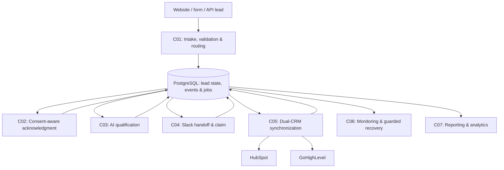

# AI Lead Automation & Dual-CRM Orchestration

**Seven coordinated n8n workflows. One PostgreSQL source of truth. Traceable lead processing from intake to sales handoff and CRM updates.**

**Project type:** Independent engineering build · **Built:** November 2026  
**Stack:** n8n · PostgreSQL · JavaScript · OpenAI API · Docker · REST APIs/webhooks · Slack · Resend · HubSpot · GoHighLevel

**Project links**

- **Video walkthrough:** [Watch on YouTube (unlisted)](https://youtu.be/f8Ul9Tdju30)
- **Repository:** [ai-lead-automation-crm-orchestration](https://github.com/usmantariq-ai/ai-lead-automation-crm-orchestration/)
- **LinkedIn:** [Professional profile](https://www.linkedin.com/in/usmantariqdev/) · [Project entries](https://www.linkedin.com/in/usmantariqdev/details/projects/)
- **Contact:** [usmantariq4799@gmail.com](mailto:usmantariq4799@gmail.com)

## The problem

A new inquiry doesn't stay in one system. It may arrive through a form, need an acknowledgment, require qualification and assignment, and eventually appear in more than one CRM. The difficult part is not making individual API calls; it's preserving a reliable record when an event is repeated, a provider times out, or a sales representative hasn't acted yet.

I built this project to explore a **state-first automation architecture**: accept a lead once, write its state to PostgreSQL, create durable downstream work, and allow each integration to progress or recover independently.

## What the system does

- Accepts authenticated incoming requests through an n8n webhook and validates required fields.
- Separates **replayed events** from a genuine new inquiry by an existing contact.
- Persists the lead, identity, owner, event history, and downstream jobs in PostgreSQL.
- Performs consent-aware acknowledgment, with time-sensitive message handling and recorded send outcomes.
- Runs AI qualification separately from intake, storing structured intent, score, and priority.
- Notifies a sales representative in Slack and tracks *assignment*, *notification*, and *claim/action* as different states.
- Synchronizes contact and ownership information with **HubSpot** and **GoHighLevel** through separate processing paths.
- Observes errors, supports controlled recovery, and produces operational reporting from recorded events.

## Architecture

**Important:** C02–C05 consume different downstream work items; they are **not** a single mandatory linear chain. C06 and C07 provide cross-system monitoring and reporting.

### The seven workflows

| Canvas | Responsibility | Engineering detail |
|---|---|---|
| **01 — Intake & Routing** | Webhook intake, validation, identity matching, replay detection, representative assignment | Establishes the lead record and queues the downstream jobs |
| **02 — Acknowledgment** | Consent and quiet-hours checks; email acknowledgment via Resend | Records eligibility and provider outcomes; does not blindly resend |
| **03 — AI Qualification** | Structured intent, urgency/priority, lead score and nurture state | Model processing does not block lead acceptance or assignment |
| **04 — Sales Handoff** | Slack notification, ownership and representative claim tracking | A sent notification is **not** treated as proof of a rep response |
| **05 — Dual CRM Sync** | Contact identification/upsert and owner/qualification mapping for two CRMs | Independent HubSpot and GoHighLevel jobs, retries and reconciliation |
| **06 — Monitoring & Recovery** | Incident capture, alerts, stalled/failed-work checks and guarded recovery | Helps isolate and recover failures without rerunning unrelated work |
| **07 — Reporting** | Lead, communication, sales, CRM and reliability summaries | Uses recorded operational events rather than inferred business results |

## The decisions that mattered

### 1. PostgreSQL owns processing state

The database is more than a destination for leads. It also records jobs and outcomes so workflows can answer questions like: *Has this event been accepted? Was this job already claimed? Did an external call finish? Should this specific work item be retried?*

This is a deliberate trade-off: more SQL and state management, in exchange for inspectable execution history and recovery paths.

### 2. Duplicate requests must be safe

Two identical webhook deliveries should not create two leads or trigger two acknowledgments. The intake design uses event identity and database-backed duplicate checks, while keeping contact identification separate from event replay detection. A new inquiry from someone already known isn't automatically a duplicate event.

### 3. Provider failure must not freeze the system

The CRM integrations use separate durable work items. A failed or uncertain result for one provider does not automatically undo a successful update in the other. Bounded retries, recorded HTTP outcomes, and reconciliation are used instead of restarting the entire chain.

An **unknown outcome** deserves special treatment: a timeout doesn't prove an external contact was never created, so the system must re-check before blindly issuing another create request.

### 4. AI helps prioritize; it doesn't decide whether the lead exists

Qualification is asynchronous. The lead can be registered and assigned even if the model is slow or unavailable. AI-derived values are stored in structured fields for downstream prioritization; operational correctness does not depend on the score being generated immediately.

### 5. Human actions are separate from automated notifications

The system distinguishes **assigned → notified → representative action/claim**. This matters for meaningful sales activity and SLA reporting: posting a Slack message is not the same as an actual customer follow-up.

## Validation and evidence

A controlled regression in the local Docker-based test environment recorded the following:

| Observation | Recorded result |
|---|---|
| Downstream job processing | **15 of 15 jobs completed** in the test window |
| New failed jobs | **0** in that same window |
| Replayed-event behavior | Duplicate-event path exercised |
| Consent rules | No-consent acknowledgment skipped; consented Resend email received provider acceptance |
| AI qualification example | **87 / purchase intent / hot priority** |
| Slack handoff | Notification sent |
| Dual CRM processing | HubSpot and GoHighLevel contact/owner sync jobs completed |
| Reporting | A separate scheduled run saved a November 11 report with four insights |

These numbers describe **observed test behavior**, not production throughput, conversion improvement, or client ROI. The reporting run above was separate from the final regression.

## A real debugging example

During the CRM integration work, requests failed despite apparently valid credentials. I isolated the failing API calls, checked HTTP responses and permission scopes, corrected required request headers and account/location mappings, and tested the provider paths independently. This reinforced the value of checking provider-specific failures before changing orchestration logic.

## Implementation boundaries and next improvements

This was a **tested portfolio system**, not a verified customer production deployment. The strongest proof is the controlled workflow/regression evidence above. At the time of the documented run:

- The email acknowledgment path was verified; optional Pingram SMS delivery was **not** verified.
- Advanced nurture sending and automatic CRM claim behavior were not enabled as completed capabilities.
- Historical incidents with unknown outcomes remained for reconciliation.
- The local Docker/ngrok environment had not been validated as a secure production deployment.

For a live rollout I would prioritize secure hosting and secret management, provider reconciliation, historical-incident cleanup, sustained failure-injection testing, and complete nurture/ownership acceptance tests.

## Repository and demonstration materials

This README documents the architecture and verified behavior. **Do not interpret the README alone as a runnable deployment or as a complete source-code release.** If publishing workflow exports later, they should be sanitized and accompanied by schema/configuration instructions and test fixtures. Never commit API keys, access tokens, webhook secrets, contact data, or CRM account identifiers.

**Supporting evidence:** The [narrated project walkthrough](https://youtu.be/f8Ul9Tdju30) shows the workflow architecture and project behavior. Screenshots of the seven canvases, the controlled regression, and CRM/Watchdog execution can be added to this repository if suitable redacted copies are available. A separate PDF case study is optional and is not required to understand this README.

---

**Built and documented by [Usman Tariq](https://www.linkedin.com/in/usmantariqdev/).**  
Questions or collaboration: [usmantariq4799@gmail.com](mailto:usmantariq4799@gmail.com).
